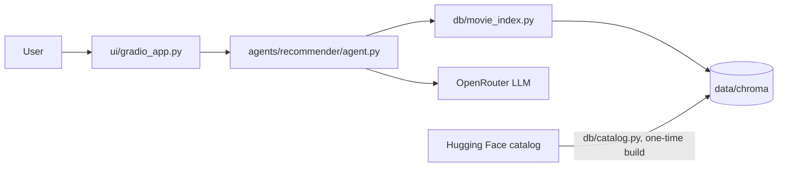
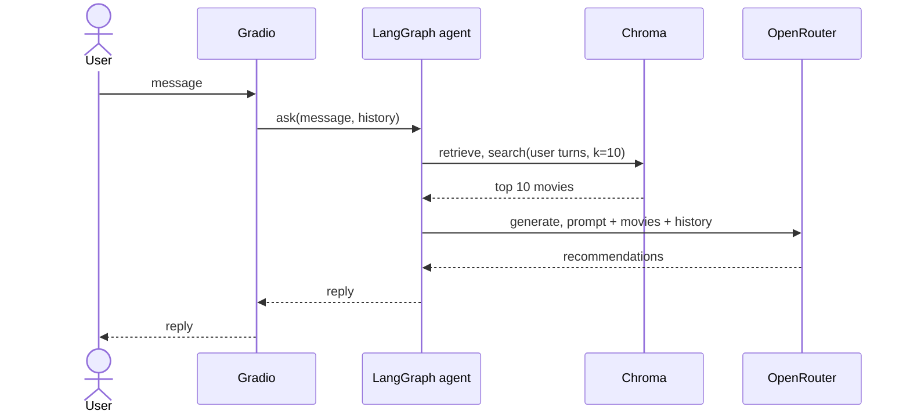

# DADS5250_AI_Movie_Discovery_Assistant
AI powered movie recommendation assistant

## Layout

```
.
|-- app.py                  entry point, launches the UI
|-- agents/recommender/     LangGraph RAG agent
|-- db/                     catalog loading and Chroma index
|-- notebooks/              data exploration
|-- scripts/                bootstrap installers
`-- ui/                     Gradio chat app
```

## Architecture



In each chat turn, Gradio passes the visible history to the agent. The agent searches Chroma with everything the user has said so far, then asks the LLM to recommend from those results.



## Setup

Run every command from the project root.

**Windows users:** use PowerShell (not Command Prompt or Git Bash) and the `.ps1` scripts. The `-ExecutionPolicy Bypass` flag avoids Windows' default "running scripts is disabled" error.

### 1. Configure

Copy the template to `.env` (gitignored, never commit it) and set `OPENAI_API_KEY` to your [OpenRouter key](https://openrouter.ai/keys). The other values have working defaults.

macOS / Linux:

```bash
[ -f .env ] || cp .env.example .env
```

Windows (PowerShell):

```powershell
if (-not (Test-Path .env)) { Copy-Item .env.example .env }
```

### 2. Install uv and dependencies

Installs [uv](https://docs.astral.sh/uv/) if missing, then the project dependencies and the Python version pinned in `pyproject.toml`. If uv was just installed, open a new terminal afterwards.

macOS / Linux:

```bash
./scripts/bootstrap.sh
```

Windows (PowerShell):

```powershell
powershell -ExecutionPolicy Bypass -File .\scripts\bootstrap.ps1
```

### 3. Build the movie index

Downloads the movie catalog from Hugging Face, embeds it into `data/chroma`, then runs a few test searches. A clean build took 30 minutes on a laptop CPU in power-saving mode. An interrupted build resumes where it stopped, and later runs skip the build.

```bash
uv run python -m db.movie_index
```

## Run

macOS / Linux:

```bash
./start.sh
```

Windows (PowerShell):

```powershell
powershell -ExecutionPolicy Bypass -File .\start.ps1
```

Open the URL printed in the terminal (default http://127.0.0.1:7860). Press Ctrl+C to stop.
